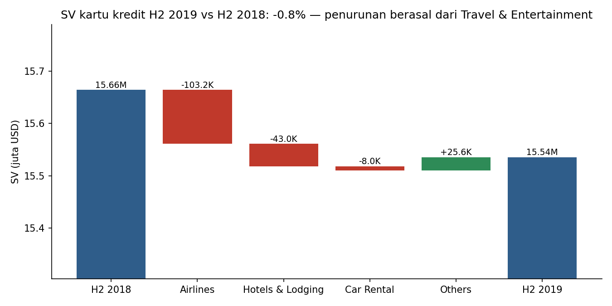
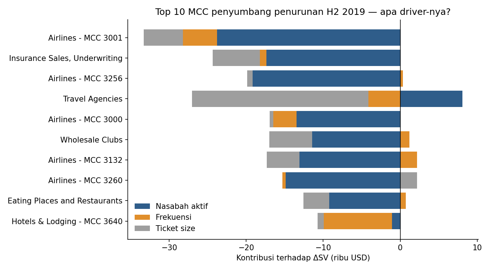
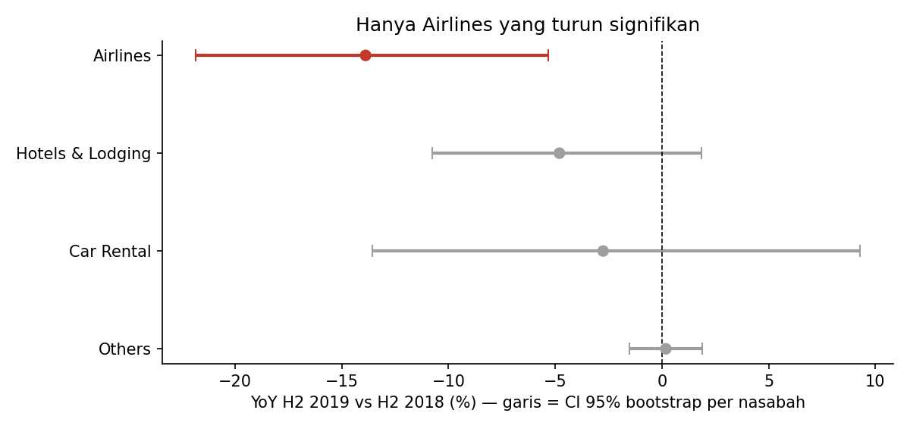
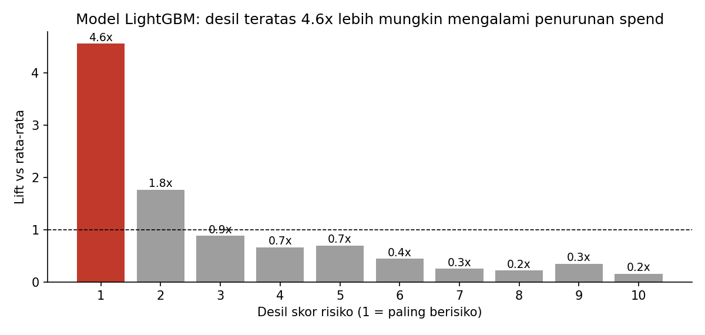
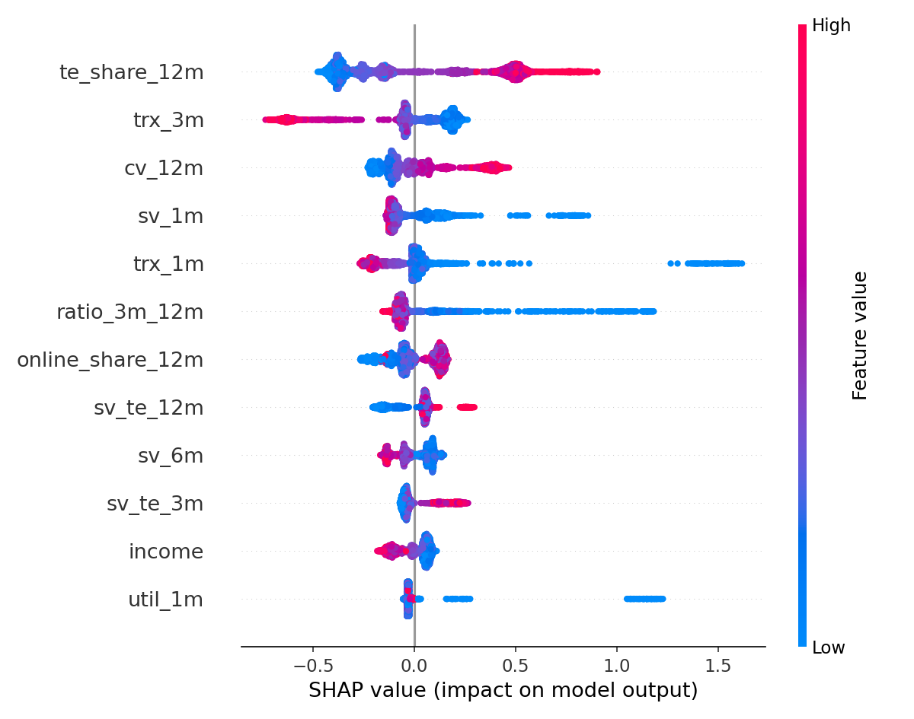

# Credit Card Spending Volume (SV) Decline Analysis
### Merchant-Level Root Cause & Customer Risk Model

> SV kartu kredit H2 2019 turun **0,8% YoY** setelah H1 tumbuh **1,1%**.
> Project ini mencari **merchant/MCC mana yang menyebabkan penurunan, apa driver-nya, apakah penurunannya signifikan, dan nasabah mana yang berisiko** — lalu membangun model machine learning untuk mendeteksi nasabah berisiko lebih awal.

---

## Ringkasan Hasil

| Pertanyaan | Jawaban |
|---|---|
| Dari mana penurunan SV berasal? | **Travel & Entertainment (T&E) turun -154,2K**, lebih besar dari penurunan bersih (-128,6K). Kategori non-T&E justru naik +25,6K |
| Kelompok mana yang turun signifikan? | **Hanya Airlines** (-13,9%, CI 95%: -21,8% s/d -5,3%) |
| Apa driver-nya? | Airlines: **nasabah hilang** · Hotel & Wholesale Club: **frekuensi turun** · Travel Agency & Department Store: **ticket size turun** |
| Siapa nasabahnya? | **232 nasabah** menyumbang 80% penurunan T&E; segmen *stopped* juga mengurangi belanja lain (*disengagement*) |
| Bisakah diprediksi? | **LightGBM: ROC-AUC 0,807, PR-AUC 0,470**, desil teratas **4,6×** lebih berisiko |



---

## Dataset

**IBM TabFormer — Synthetic Credit Card Transactions** ([Kaggle: ealtman2019/credit-card-transactions](https://www.kaggle.com/datasets/ealtman2019/credit-card-transactions))

| File | Isi |
|---|---|
| `credit_card_transactions-ibm_v2.csv` | 24,4 juta transaksi (1991 – Feb 2020), 2.000 nasabah, 100 ribu merchant, 109 MCC |
| `sd254_users.csv` | Profil nasabah: umur, income, total utang, FICO score |
| `sd254_cards.csv` | 6.146 kartu: jenis (Credit/Debit/Prepaid), brand, credit limit |
| `mcc_codes.json` | Deskripsi MCC ([Kaggle: computingvictor/transactions-fraud-datasets](https://www.kaggle.com/datasets/computingvictor/transactions-fraud-datasets)) |

### Keputusan data cleaning

| Keputusan | Alasan |
|---|---|
| Hanya **kartu kredit** (38,6% SV; 980 nasabah, 1.403 kartu) | Data mencampur debit (57,8%) dan prepaid (3,6%) |
| Buang refund, transaksi error, fraud, dan nominal $0 | SV = spend purchase yang benar-benar terjadi |
| Periode **2017–2019**, fokus **H2 2019 vs H2 2018 (YoY)** | Jan–Feb 2020 anomali (+369 nasabah baru mendadak); YoY menetralkan musiman |
| Deskripsi MCC 3000–3999 diganti nama kelompok | `mcc_codes.json` tidak sesuai standar (mis. 3001 = "Steel Products"). Perilaku transaksi (ticket ±$716, ±1× per semester, 1 merchant per MCC) menunjukkan maskapai/hotel/rental |
| User ID = nomor baris `sd254_users.csv` | File tidak punya kolom ID; divalidasi lewat jumlah kartu dan lokasi transaksi |

> **Catatan KPI:** penurunan MoM mentah (mis. Februari -9%) hanyalah efek jumlah hari. Setelah dinormalisasi per hari, fluktuasi bulanan < ±2,5%. Karena itu analisis memakai **YoY** dan **SV per hari**.

---

## Metodologi

| Step | Metode | Output |
|---|---|---|
| 1. Data preparation | Chunked loading 2,3 GB CSV, join kartu, flag refund/error/fraud | Parquet kartu kredit 2017–2020 |
| 2. KPI & periode | Mapping MCC + kelompok T&E, normalisasi SV per hari, YoY per semester | Periode fokus H2 2019 |
| 3. Dekomposisi | **LMDI** — ΔSV = Δ(nasabah aktif) + Δ(frekuensi) + Δ(ticket size), di level total, kelompok MCC, MCC, merchant | Kontribusi driver yang menjumlah tepat ke ΔSV |
| 4. Bridge nasabah | Klasifikasi *stopped / decreased / increased / new* + profil nasabah | Siapa di balik penurunan |
| 5. Uji signifikansi | **Bootstrap per nasabah** (2.000 iterasi), CI 95%, tahun kontrol 2018 vs 2017 | Penurunan mana yang bukan kebetulan |
| 6. Model risiko | LightGBM vs Logistic Regression vs rule baseline, **time-based split**, SHAP | Skor risiko nasabah + driver |
| 7. Report | Visualisasi & rekomendasi | 5 grafik utama |

---

## Temuan Utama

### 1. Penurunan berasal dari Travel & Entertainment

| Kelompok | SV H2 2018 | SV H2 2019 | ΔSV | YoY |
|---|---:|---:|---:|---:|
| Airlines | 743,8K | 640,5K | **-103,2K** | **-13,9%** |
| Hotels & Lodging | 895,7K | 852,7K | -43,0K | -4,8% |
| Car Rental | 289,5K | 281,5K | -8,0K | -2,8% |
| Others | 13,74M | 13,76M | +25,6K | +0,2% |
| **Total** | **15,66M** | **15,54M** | **-128,6K** | **-0,8%** |

Di level total, nasabah aktif justru **naik** (912 → 935); penurunan datang dari **frekuensi** (-322,5K) dan **ticket size** (-194,6K).

### 2. Driver berbeda per merchant



- **Airlines (MCC 3001, 3256, 3000, 3132, 3260): nasabah hilang** — mis. MCC 3001 turun 37,7% (108 → 77 nasabah)
- **Hotel MCC 3640 & Wholesale Clubs: frekuensi turun**
- **Travel Agencies & Department Stores: ticket size turun** — Travel Agencies justru bertambah nasabah

### 3. Hanya Airlines yang turun signifikan



Pada tahun kontrol (2018 vs 2017) tidak ada kelompok yang turun signifikan. Di level MCC, jumlah MCC "signifikan" setara tahun kontrol (efek *multiple testing*), sehingga hanya **MCC 3001** yang dilaporkan karena konsisten dengan hasil dekomposisi.

### 4. Penurunan terkonsentrasi pada sedikit nasabah

| Status T&E | Nasabah | ΔT&E | ΔNon-T&E | Interpretasi |
|---|---:|---:|---:|---|
| Decreased | 395 | -619,8K | +152,7K | Kurangi travel, sebagian pindah kategori (**substitusi**) |
| Stopped | 87 | -136,1K | -188,2K | Berhenti travel **dan** kurangi belanja lain (**disengagement**) |
| Increased | 322 | +460,4K | -97,0K | Penyeimbang |
| New | 106 | +141,4K | +168,3K | Nasabah baru T&E |

- **232 dari 482 nasabah** menyumbang 80% penurunan T&E
- Khusus Airlines: **214 nasabah berhenti** (-233,8K) dan juga mengurangi belanja lain sebesar -242,5K
- Profil statis (FICO, umur, porsi online) **hampir sama** antar status → perlu fitur perilaku transaksi untuk prediksi

### 5. Model risiko nasabah

**Target:** spend 3 bulan ke depan < 70% dari rata-rata kuartalan 12 bulan terakhir.
**Split:** train (cutoff Des 2017 – Sep 2018) · validasi (Des 2018 – Feb 2019) · **test (Jun – Sep 2019, target = H2 2019)**, dengan jeda agar window target tidak tumpang tindih.

| Model | ROC-AUC | PR-AUC | Precision@10% |
|---|---:|---:|---:|
| Rule (transaksi 3 bulan rendah) | 0,749 | 0,370 | 29,5% |
| **LightGBM** (dipilih via validasi) | **0,807** | **0,470** | **39,6%** |

*Base rate test: 8,7%. Logistic Regression di validasi: PR-AUC 0,429 vs LightGBM 0,445.*



- Desil skor teratas **4,6×** lebih berisiko dari rata-rata
- Top 10% nasabah (91 orang) menangkap **19,8%** penurunan spend Jul–Sep 2019



**Driver risiko (SHAP):** porsi spend T&E tinggi ↑ · transaksi 1–3 bulan terakhir sedikit ↑ · pola spend fluktuatif ↑ · momentum spend di bawah kebiasaan ↑ · income lebih tinggi ↓

---

## Rekomendasi Bisnis

| Temuan | Rekomendasi | Metrik keberhasilan |
|---|---|---|
| Airlines: nasabah hilang | Reaktivasi nasabah yang pernah bertransaksi di MCC airline terkait (cashback/bonus poin tiket); evaluasi kerja sama co-brand | Nasabah aktif per MCC airline |
| Hotel: frekuensi turun | Promo berbasis jumlah menginap / loyalty | Transaksi per nasabah MCC hotel |
| Travel Agency: ticket size turun | Cicilan 0% untuk transaksi travel bernominal besar | Ticket size MCC 4722 |
| Segmen *stopped* (disengagement) | Prioritas retensi sebelum kartu benar-benar tidak dipakai | Spend 3 bulan pasca-intervensi vs kontrol |
| Skor risiko ML | Scoring bulanan, targetkan desil 1–2, validasi dengan **A/B test** | Uplift spend treatment vs kontrol |
| Monitoring KPI | Laporan SV wajib menyertakan YoY, SV per hari, dan dekomposisi driver | Tidak ada alarm palsu dari efek kalender |

---

## Keterbatasan

- **Data sintetis** — pola realistis, tetapi penyebab penurunan tidak dapat diverifikasi ke kejadian nyata
- Deskripsi MCC 3000–3999 dikoreksi berdasarkan rentang kode standar dan bukti perilaku transaksi, bukan nama merchant asli
- Rotasi merchant long-tail sangat besar (*lost* -702K vs *new* +687K) dan kemungkinan artefak simulasi, sehingga tidak dijadikan temuan utama
- Sinyal `te_share_12m` sebagian mencerminkan sifat spend travel yang memang tidak rutin
- Model bersifat **prediktif, bukan kausal** — efek intervensi harus dibuktikan lewat A/B test

---

## Cara Menjalankan

1. Download dataset dari Kaggle (lihat bagian Dataset), lalu susun di Google Drive:
   ```
   MyDrive/
   └── sv_project/
       ├── credit_card_transactions-ibm_v2.csv.zip
       ├── sd254_users.csv
       ├── sd254_cards.csv
       └── mcc_codes.json
   ```
2. Buka `credit_card_sales_volume.ipynb` di Google Colab
3. **Runtime → Run all** (Step 1 ± 3–5 menit; hasil antara disimpan sebagai parquet/CSV di folder yang sama)

## Struktur Repository

```
├── credit_card_sales_volume.ipynb   # notebook lengkap Step 1–7
├── README.md
└── images/
    ├── fig1_waterfall.png
    ├── fig2_driver_mcc.png
    ├── fig3_bootstrap_ci.png
    ├── fig4_lift.png
    └── s6_shap_summary.png
```

## Tools

Python · pandas · NumPy · LightGBM · scikit-learn · SHAP · Matplotlib · Google Colab
